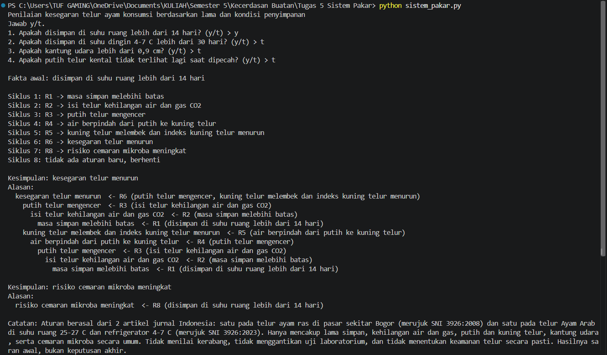
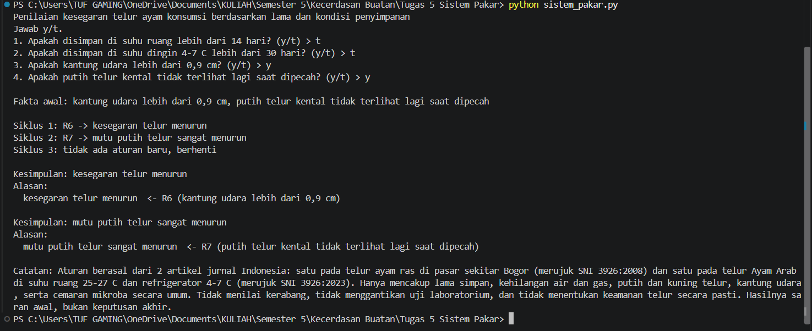
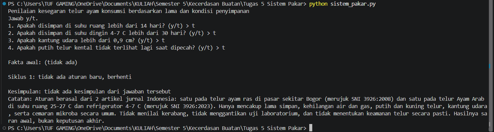

# Sistem Pakar Sederhana: Kesegaran Telur Ayam Konsumsi

Tugas 5 Kecerdasan Buatan (Materi 5)

## 1. Identitas

- Nama: Fatriya Annastha Putra
- NIM: F1D02410046

## 2. Topik dan cara menjalankan

Topik: penilaian kesegaran telur ayam konsumsi berdasarkan lama dan kondisi penyimpanan. Program menanyakan empat hal tentang telur, lalu menyimpulkan apa yang terjadi pada telur itu beserta alasannya.

- Bahasa pemrograman: Python 3.14.4
- Tidak ada pustaka tambahan (hanya modul bawaan `json` dan `sys`)
- File: `sistem_pakar.py` (program) dan `kb_telur.json` (basis pengetahuan)

Cara menjalankan: simpan kedua file di satu folder, buka terminal, lalu ketik:
python sistem_pakar.py

Jawab setiap pertanyaan dengan `y` (ya) atau `t` (tidak). Program membaca `kb_telur.json` secara bawaan. Berkas aturan lain dapat dipakai dengan `python sistem_pakar.py nama_file.json`.

## 3. Sumber dan tabel aturan

- S1: Suharyanto, Sulaiman, Zebua, dan Arief. "Kualitas Fisik, Mikrobiologis, dan Organoleptik Telur Konsumsi yang Beredar di Sekitar Kampus IPB, Darmaga, Bogor." Jurnal Ilmu Produksi dan Teknologi Hasil Peternakan, vol 4 no 2, hlm 275-279, Juni 2016, IPB University. https://journal.ipb.ac.id/index.php/ipthp/article/download/17502/12559
- S2: Pisestyani, Wijaya, Handharyani, dan Lukman. "Kualitas Telur Ayam Arab Konsumsi dan Perubahan Mutunya selama Penyimpanan pada Suhu yang Berbeda." Jurnal Nukleus Peternakan, vol 13 no 1, hlm 64-78, Juni 2026, Universitas Nusa Cendana. https://ejurnal.undana.ac.id/index.php/nukleus/article/download/24992/10193

Fakta dasar yang ditanyakan ke pengguna adalah kondisi yang tidak pernah menjadi hasil aturan lain. Sisanya diturunkan oleh program.

Aturan : IF ==> THEN (Sumber)
----------------------------
1. R1 : disimpan di suhu ruang lebih dari 14 hari **OR** disimpan di suhu dingin 4-7 C lebih dari 30 hari ==> masa simpan melebihi batas (S2)
2. R2 : masa simpan melebihi batas ==> isi telur kehilangan air dan gas CO2 (S1, S2) 
3. R3 : isi telur kehilangan air dan gas CO2 ==> putih telur mengencer (S1, S2) 
4. R4 : putih telur mengencer ==> air berpindah dari putih ke kuning telur (S2) 
5. R5 : air berpindah dari putih ke kuning telur ==> kuning telur melembek dan indeks kuning telur menurun (S1, S2)
6. R6 : putih telur mengencer **OR** kuning telur melembek dan indeks kuning telur menurun **OR** kantung udara lebih dari 0,9 cm ==> kesegaran telur menurun (S1, S2)
7. R7 : putih telur kental tidak terlihat lagi saat dipecah ==> mutu putih telur sangat menurun (S2) 
8. R8 : disimpan di suhu ruang lebih dari 14 hari ==> risiko cemaran mikroba meningkat (S1, S2) 

Ada 8 aturan dan 3 kesimpulan akhir (kesegaran telur menurun, mutu putih telur sangat menurun, risiko cemaran mikroba meningkat). Aturan yang memakai hasil aturan lain: R2 memakai hasil R1, R3 memakai hasil R2, R4 memakai hasil R3, R5 memakai hasil R4, dan R6 memakai hasil R3 dan R5.

## 4. Metode: forward chaining

Saya memilih forward chaining (FC). Alasannya, pengguna mengetahui fakta-fakta awal tentang telurnya (lama simpan, kantung udara, kondisi putih telur), lalu kesimpulan perlu ditarik dari fakta itu. Kedua sumber juga menjelaskan urutan sebab-akibat yang maju dari lama simpan sampai penurunan kesegaran, sehingga cocok dijalankan sebagai rantai aturan.

Cara kerja program: memori diisi fakta yang dijawab "ya" oleh pengguna. Lalu program mengulang: cari aturan yang syaratnya terpenuhi oleh memori (mode "dan" berarti semua syarat harus ada, mode "atau" berarti salah satu cukup) dan hasilnya belum ada di memori, ambil aturan pertama, tambahkan hasilnya ke memori, dan catat aturan asalnya. Perulangan berhenti ketika tidak ada aturan baru. Catatan asal hasil dipakai untuk menampilkan alasan. Kesimpulan akhir adalah hasil yang tidak dipakai sebagai syarat aturan lain.

## 5. Tiga kasus uji

**Kasus 1: disimpan di suhu ruang lebih dari 14 hari (jawaban: y, t, t, t).** Program menjalankan R1 sampai R6 dan R8 dalam 7 siklus, lalu berhenti pada siklus ke-8. Kesimpulannya: kesegaran telur menurun dan risiko cemaran mikroba meningkat, lengkap dengan rantai alasannya.

**Kasus 2: kantung udara lebih dari 0,9 cm dan putih telur kental tidak terlihat lagi (jawaban: t, t, y, y).** Program menjalankan R6 dan R7. Kesimpulannya: kesegaran telur menurun dan mutu putih telur sangat menurun.

**Kasus 3 (negatif): semua jawaban tidak (t, t, t, t).** Tidak ada aturan yang cocok, sehingga program menampilkan bahwa tidak ada kesimpulan.

## 6. Batas keberlakuan

Pengetahuan dalam program ini berasal dari dua artikel jurnal Indonesia: penelitian Suharyanto dkk. (2016) pada telur ayam ras yang dijual di sekitar kampus IPB Bogor, dan penelitian Pisestyani dkk. (2026) pada telur Ayam Arab yang disimpan di suhu ruang 25-27 C dan refrigerator 4-7 C; angka batas simpan 14 dan 30 hari di R1 berasal dari kutipan artikel kedua terhadap SNI 3926:2023, bukan dari dokumen SNI-nya langsung. Program ini hanya dimaksudkan sebagai saran awal untuk menilai penurunan kesegaran telur ayam konsumsi dari lama simpan dan beberapa tanda fisik, tidak menilai kerabang, tidak menggantikan uji laboratorium, dan tidak menentukan keamanan telur secara pasti, sehingga hasilnya bukan keputusan akhir. Catatan yang sama ditampilkan oleh program di akhir setiap keluaran.

## 7. Penggunaan alat bantu AI

Saya memakai AI Claude sebagai alat bantu AI dalam tugas ini. Claude membantu mencari artikel sumber, membantu menyusun kode program `sistem_pakar.py` beserta berkas `kb_telur.json`, dan menyusun draf README ini. Program dijalankan di komputer saya sendiri dan ketiga screenshot di atas adalah hasil yang saya menjalankannya.
